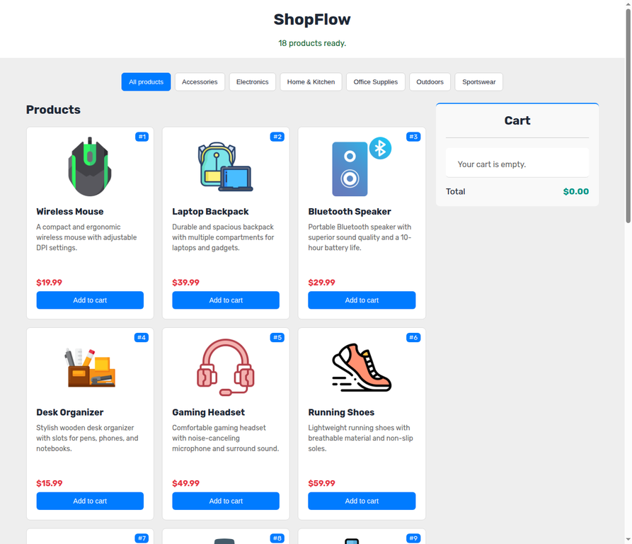

# 🛒 Simple E-commerce Product Listing with Cart Functionality

> **Live demo:** [Open ShopFlow in your browser](https://9gkc.github.io/ShopFlow/)

## Interface preview



**[Open the live ShopFlow demo](https://9gkc.github.io/ShopFlow/)**. The catalogue and cart are an educational client-side demo; cart entries are stored in the browser’s local storage and do not represent live inventory, customer orders, ratings, or transactions.

<div align="center">
  
  
  
</div>


[](https://opensource.org/licenses/MIT)
[](https://developer.mozilla.org/en-US/docs/Web/HTML)
[](https://developer.mozilla.org/en-US/docs/Web/CSS)
[](https://developer.mozilla.org/en-US/docs/Web/JavaScript)

## ✨ Overview

This project demonstrates a basic e-commerce product listing page with client-side cart functionality. Users can browse products, filter them by category, add items to their cart, and view the total amount. The cart data is persisted using `localStorage`.

## 🚀 Features

- **Product Listing**: Displays a variety of products fetched from a `products.json` file.
- **Category Filtering**: Users can filter products by different categories using the navigation bar.
- **Add to Cart**: Easily add products to the shopping cart with a single click.
- **Cart Management**: View items in the cart, adjust quantity, and remove items.
- **Total Calculation**: Automatically calculates and displays the total amount of items in the cart.
- **Safe Rendering**: Product and cart values are rendered through DOM APIs rather than HTML interpolation.
- **Validation and Error States**: Product data and saved cart entries are validated, with clear loading and error messages.
- **Local Storage Persistence**: Cart data is saved in the browser's `localStorage`, so it persists across sessions.
- **Responsive Design**: Adapts to different screen sizes for a seamless user experience.

## 🛠️ Technologies Used

- **HTML5**: For structuring the web content.
- **CSS3**: For styling the application, including responsive design.
- **JavaScript (ES6+)**: For dynamic behavior, product fetching, cart logic, and DOM manipulation.
- **JSON**: To store product data.

## ⚙️ How to Run Locally

Follow these simple steps to get the project up and running on your local machine:

1.  **Clone the repository**:
    ```bash
    git clone https://github.com/9gkc/ShopFlow.git
    ```
2.  **Navigate to the project directory**:
    ```bash
    cd ShopFlow
    ```
3.  **Serve the project over HTTP** because the app fetches `products.json`:
    ```bash
    python3 -m http.server
    # Then open http://localhost:8000
    ```

    ```bash
    # Example using a simple Python HTTP server
    python3 -m http.server
    # Then open http://localhost:8000 in your browser
    ```

## 🤝 Contributing

Contributions are welcome! If you have suggestions for improvements or new features, please feel free to open an issue or submit a pull request.

## 📄 License

This project is licensed under the MIT License - see the [LICENSE](LICENSE) file for details.

## 📧 Contact

For any questions or inquiries, please contact [alkarara70cys@gmail.com].
